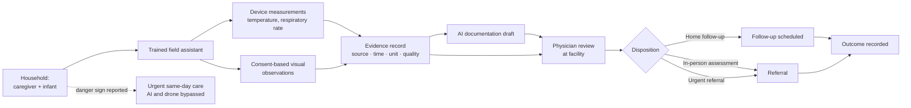

# Operations

## Household operation diagram

## Failure handling

- Flight not possible → community teleconsultation or facility visit.
- Connectivity loss → unusable measurements are recorded as unusable, not normal.
- Inadequate image quality → "Unable to assess"; arrange in-person review.
- Equipment failure → logged; the clinical pathway continues without the drone.

The drone must demonstrate added value against community teleconsultation, existing outreach visits,
and household travel before it is justified.
